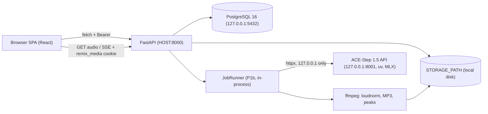

# Remix Studio v2 — Design Spec

**Date:** 2026-10-31
**Status:** Approved by the user (plan v2 plus the corrections in section 3).
**Plan of record:** `/Users/mingjie/.cursor/plans/ai_song_generation_and_studio_ui_8d257238.plan.md` (Chinese, v2). Where this spec and plan v2 disagree, this spec wins.
**Repository:** `audio-remix-lab`, with `song-remix-backend/` (FastAPI), `song-remix-ui/` (React 19 + Vite 8 + TanStack Router) and `acestep/` (ACE-Step 1.5 git submodule).

---

## 1. Goal

Turn audio-remix-lab into a multi-user AI song studio that uses ACE-Step 1.5 as its only engine. The work happens in three steps:

1. **Foundation.** Fix security and infrastructure: storage keys instead of client paths, ownership everywhere, cookie-authenticated media, production-style serving, a test harness and Suno removal.
2. **Generation v2.** Build it on the ACE-Step contract as verified against the real engine:
   - text2music, cover, repaint and extend
   - 1–4 variants per task
   - FLAC masters normalized to −14 LUFS, plus derived MP3 and peaks
3. **UI redesign.** A song-centric two-pane workspace with mineral-night tokens and one global waveform player.

The app runs on one Mac (M4 Max, 64 GB). It is shared through LAN or an HTTPS tunnel and verified on desktop only, at 1024 px and 1440 px widths.

## 2. Locked decisions

| Area | Decision |
|---|---|
| Engine | ACE-Step 1.5 only. Suno is deleted entirely: engine, config, env vars including `TWOCAPTCHA_KEY`, compose service, README sections and the UI engine picker. |
| Model choice | Set at startup through env vars (`ACESTEP_MODEL`, `ACESTEP_LM_MODEL`). There is no per-request model switch, because ACE-Step silently falls back to the default model when asked for one that isn't loaded. |
| Users | A full multi-user app with per-user data isolation. Bearer tokens are used for `fetch`. An HttpOnly cookie is used only for GET audio, download and SSE. Registration can require an invite code (`REGISTRATION_INVITE_CODE`). |
| Serving | `make serve` builds the UI and FastAPI serves `dist/` with SPA fallback and no reload. `HOST` defaults to `127.0.0.1`. ACE-Step always binds `127.0.0.1`. |
| Keep vocals (`complete`) | Deferred, because it needs the base model resident. |
| Design | Port mineral-night tokens and the design-taste rules only; there is no dependency on the mingjie-ui packages. Desktop only. |
| Review | One Opus reviewer per task, giving two verdicts: spec compliance and code quality. At most 2 fix rounds, then escalate to the user. |
| Process | Phases run strictly in order, each on branch `phase/N-name` in `.worktrees/`, and each merges to main after its gate. |

## 3. Corrections to plan v2

These are verified against ACE-Step v0.1.8 source (`dce6214`) and current library releases. Each one supersedes the corresponding statement in plan v2.

1. **Failure text.** `/query_result` reads the diskcache entry first, and cached failure items carry `status`, `progress`, `stage: "failed"`, `file`, `wave`, `create_time` and `env`, but **no `error` text**. Only the in-memory store fallback adds `error`. Adapter rule:
   - Use `result[0].error` when it is present.
   - Otherwise use the item's `progress_text` when it is non-empty.
   - Otherwise use `"ACE-Step reported a failure without details"`.

   P1a records which path real failures take.
2. **Queue full.** The 429 response is **unwrapped**: `HTTP 429 {"detail": "Server busy: queue is full"}`. It does **not** include `queue_position`. `queue_position` only appears in the wrapped 200 response to `/release_task`: `{"data": {"task_id", "status": "queued", "queue_position"}, "code": 200, ...}`.
3. **Unknown task ids** never produce "not found". `/query_result` returns `{"task_id": X, "result": "[]", "status": 0}` forever, so the runner must detect "empty result list" itself (section 10). P1a must show whether a *queued* task also returns an empty list, because if so a queued task and an unknown task look identical.
4. **Stale running entries.** A job interrupted by an ACE-Step restart keeps its cached `status 0` until 3600 s (`TASK_TIMEOUT_SECONDS`) after creation, then flips to `status 2`. The backend generation timeout must stay below 3600 s.
5. **`src_audio_path` (JSON).** Relative paths without traversal are accepted, and so are absolute paths *inside the system temp dir*. Other absolute paths get 400. We always upload multipart `src_audio`, so this is informational.
6. **`lm_backend`.** The request-level default is `"vllm"`, so every request sends `lm_backend=mlx` explicitly. The server is also started with `ACESTEP_LM_BACKEND=mlx`.
7. **`audio_format`.** The default is `mp3`, so every request sends `audio_format=flac`.
8. **`seed_value`.** It is a comma-joined string of *all* batch seeds and is repeated on every result item. The per-variant seed is `seed_value.split(",")[variant_index]`. `seed_value` and `dit_model` exist only on the cached path; the store fallback lacks them. The `dit_model` check therefore runs only when the field is present, and P1a records how often it is absent.
9. **Peaks** are stored per variant (`{variant}.peaks.json`), not once per task.
10. **Passwords.** bcrypt 5 raises `ValueError` for passwords over 72 bytes. Passwords are 8 characters minimum and 72 UTF-8 bytes maximum, and `verify_password` returns `False` above 72 bytes.
11. **Node.** vitest 5 needs `^22.12 || ^24 || >=26` and jsdom 30 needs `^22.22.2 || ^24.15 || >=26`. The installed Node 23 is unsupported, so the repo pins Node 24 via `.nvmrc`.
12. **msw** is pinned to `^2.15.0`. v3 is ESM-only and renames `onUnhandledRequest`.
13. **Proxy headers.** uvicorn trusts `X-Forwarded-For` only from `127.0.0.1` by default. A local tunnel daemon (cloudflared, `tailscale serve`) connects from 127.0.0.1, so the login rate limit keys on the real client IP. Direct LAN clients are keyed by socket IP.
14. **Upload removal.** `/api/upload/audio` and `SongUpdate.source_audio_path` are removed in P0, not deprecated. They are the arbitrary-file-read hole, so the UI switches to `POST /api/songs/{id}/source` in the same task.
15. **Size cap.** `MAX_UPLOAD_MB` (MiB) defaults to 128 (it was 50) so that a 10-minute 44.1 kHz 16-bit stereo WAV (105,840,000 bytes, 100.9 MiB) fits. Uploads above 600 s are rejected anyway.

## 4. Architecture



- **Single backend process.** `make serve` runs one uvicorn worker without `--reload`. That makes in-process state safe: the login rate limiter and, from P1b, the JobRunner and its GPU-lane semaphore. Running more than one worker is unsupported.
- **ACE-Step** runs as a separate process from the pinned submodule (`make acestep`, `uv run acestep-api`). One queue worker (`ACESTEP_QUEUE_WORKERS=1`).
- **Postgres** comes from `docker compose` (project `audio-remix-lab`, postgres only). Everything else runs natively on macOS.
- **The frontend** uses the Vite dev server in `make dev` (proxy `/api` to `:8000`) and is static files served by FastAPI in `make serve`.

## 5. Data model

### 5.1 After P0

| Table | Columns (changes in **bold**) |
|---|---|
| `users` | id, email (unique), username, hashed_password, created_at, updated_at |
| `songs` | id, title, artist, lyrics, **source_audio_key** (renamed from `source_audio_path`; holds a relative storage key), created_by → users, created_at |
| `generation_tasks` | id, song_id → songs, user_id → users, engine, engine_task_id, status, style_preset_id → style_presets, style_prompt, vocal_gender, engine_params JSON, output_audio_path (legacy, server-only), duration_seconds, retry_count, error_message, metadata JSON, created_at, started_at, completed_at |
| `style_presets` | id, name, description, acestep_caption, ~~suno_tags~~ (**dropped**), category_tags JSON, cover_art_emoji, is_builtin, user_id → users, created_at |

ORM notes:
- `Song.tasks` is ordered by `created_at desc`.
- `User.songs` and `User.tasks` are `lazy="raise"`, so they are never loaded implicitly.
- `Song.has_source` and `GenerationTask.has_output` are computed properties for responses.

### 5.2 P1b (one migration, ordered so that FKs exist before they are referenced)

- **`generation_tasks` gains:**
  - `mode` (String 20, `server_default 'cover'`, NOT NULL)
  - `stage` (String 30, nullable)
  - `progress` (Float, nullable, 0..1)
  - `request_params` (JSON)
  - `cancelled_at` (timestamptz)
  - `parent_output_id` → `task_outputs.id` with `ondelete=SET NULL`. It is added with `op.create_foreign_key` after `task_outputs` exists.
- **New table `task_outputs`:**
  - id, task_id → generation_tasks (`ondelete=CASCADE`), variant_index
  - flac_key, mp3_key, peaks_key
  - duration, seed, bpm, key_scale, lufs
  - is_favorite (default false)
  - `metadata` JSON, mapped as `metadata_`
  - created_at
  - Unique key on `(task_id, variant_index)`.
- **`style_presets` gains** `default_strength` (Float, nullable) and `bpm` (Integer, nullable).
- **Backfill.** Every task with `output_audio_path` gets a `variant_index=0` output. The absolute legacy path is converted to a key only when it resolves inside `STORAGE_PATH`; otherwise the output is skipped and the task keeps `has_output=false`.
- `generation_tasks.output_audio_path` is dropped by a separate migration at the end of P3.

## 6. ACE-Step contract (v0.1.8, commit `dce6214`, verified from source)

### 6.1 Process

- **Start:**

  ```bash
  cd acestep && ACESTEP_CONFIG_PATH=<dit> ACESTEP_LM_MODEL_PATH=<lm> ACESTEP_LM_BACKEND=mlx ACESTEP_INIT_LLM=true ACESTEP_NO_INIT=false TOKENIZERS_PARALLELISM=false uv run acestep-api --host 127.0.0.1 --port 8001
  ```

  - `requires-python >=3.11,<3.13`.
  - Never use `start_api_server_macos.sh`: it prompts interactively and may `git pull`.
- **Models:**
  - The DiT default is `acestep-v15-turbo`. The XL options are `acestep-v15-xl-turbo`, `-xl-sft` and `-xl-base`, each a separate Hugging Face repo `ACE-Step/<name>`.
  - The LM default is `acestep-5Hz-lm-1.7B`; the alternatives are `-0.6B` and `-4B`.
  - `uv run acestep-download` (no args) fetches the main repo, which contains the turbo DiT and the 1.7B LM. `--model <name>` fetches one model. `ACESTEP_CHECKPOINTS_DIR` overrides the location.
- **Other env vars:**
  - `ACESTEP_DEVICE` (auto)
  - `ACESTEP_OFFLOAD_TO_CPU`
  - `ACESTEP_QUEUE_MAXSIZE` (200)
  - `ACESTEP_QUEUE_WORKERS` (1)
  - `ACESTEP_TMPDIR`
  - `ACESTEP_DOWNLOAD_SOURCE`
  - `ACESTEP_API_KEY` (unused; loopback only)
- **MLX** log lines are prefixed `[MLX-DiT]` and `[MLX-VAE]`. A failure line such as "MLX not available… skipping" or "Failed to initialize MLX decoder (non-fatal)" means it fell back to PyTorch/MPS. P1a records which path the turbo and XL models take.

### 6.2 Endpoints

| Endpoint | Shape |
|---|---|
| `POST /release_task` | JSON or multipart. File fields `src_audio` (or `ctx_audio`) and `ref_audio`. Wrapped response `{"data": {"task_id", "status": "queued", "queue_position"}, "code": 200, "error": null, "timestamp", "extra": null}`. Returns 429 `{"detail": "Server busy: queue is full"}` when the queue is full. |
| `POST /query_result` | Body `{"task_id_list": [ids]}`. Wrapped `data` is a list of `{task_id, status: 0\|1\|2, result: <JSON string of a list>, progress_text}`. |
| `GET /v1/audio?path=<abs>` | Serves only files inside `acestep/.cache/acestep/tmp/api_audio`. |
| `GET /health` | Wrapped `{status: "ok", service: "ACE-Step API", version: "1.0", models_initialized, llm_initialized, loaded_model, loaded_lm_model}`. |
| `GET /v1/models` (also `/v1/model_inventory`) | `{models: [{name, is_default, is_loaded, supported_task_types}], default_model, lm_models: [{name, is_loaded}], loaded_lm_model, llm_initialized}`. |
| `GET /v1/stats` | `{jobs: {queued, running, succeeded, failed, ...}, queue_size, queue_maxsize, avg_job_seconds}`. |
| `POST /v1/init` | Lazy model init (unused, because we start with `ACESTEP_NO_INIT=false`). |

### 6.3 Request fields we use

| Field | Notes |
|---|---|
| `task_type` | `text2music`, `cover` or `repaint` (also `cover-nofsq`). Turbo models support `["text2music","repaint","cover","cover-nofsq"]`; `extract`, `lego` and `complete` are base-only. **There is no `extend` task type.** |
| `prompt` | Alias `caption`. It carries the vocal gender hint, because there is no `vocal_gender` field. |
| `lyrics` | Uses `[Verse]`, `[Chorus]` and `[Bridge]` tags. |
| `vocal_language` | Request default is `"en"`. |
| `bpm`, `key_scale`, `time_signature` | Optional and explicit. |
| `audio_duration` | 10–600 s. Ignored for cover, whose output length equals the source. |
| `batch_size` | The UI exposes 1–4. |
| `inference_steps` | Default 8. |
| `guidance_scale` | Default 7.0; we don't send it. |
| `use_random_seed` / `seed` | `use_random_seed=false` is required for a fixed seed. `seed` is an int or a comma string with one value per variant, default −1. |
| `audio_cover_strength` | Default 1.0. The UI default is 0.6, and 0.2 means "style only". |
| `repainting_start` / `repainting_end` | `repainting_end=-1` means "to the end of the source". **Extend means `repaint` with `repainting_end` greater than the source duration**; the source is padded with silence. |
| `audio_format` | Always `flac`. |
| `lm_backend` | Always `mlx`. |
| `full_analysis_only` | Takes `src_audio`. Returns `{status_message: "Full Hardware Analysis Success", bpm, keyscale, timesignature, duration, genre, prompt, lyrics, language, metas, audio_codes}`. |

### 6.4 Result items (`json.loads(item["result"])`)

| Path | Fields |
|---|---|
| Cached success (one item per audio) | `file` (`/v1/audio?path=<urlencoded abs>`), `wave`, `status`, `create_time`, `env`, `prompt`, `lyrics`, `metas` {bpm, duration, genres, keyscale, timesignature, prompt, lyrics}, `generation_info`, `seed_value`, `lm_model`, `dit_model`, `progress: 1.0`, `stage: "succeeded"` |
| Cached running | `progress`, `stage` (status 0) |
| Cached failure | `file`, `wave`, `status`, `create_time`, `env`, `progress: 0.0`, `stage: "failed"` (no `error`) |
| Store fallback | Like success, but without `seed_value` and `dit_model`. Has `error` when not succeeded. |
| Unknown id | `result: "[]"`, `status: 0` |

- **Persistence.** The diskcache lives at `acestep/.cache/acestep/local_redis` with a 7-day TTL and survives restarts. The in-memory store is lost on restart and is cleaned up after 24 h.
- **To verify in P1a:**
  - Whether results and audio files survive a restart.
  - What a mid-run task looks like after a restart.
  - Whether a queued task is distinguishable from an unknown one.

## 7. API contract

### 7.1 Endpoints after P0

| Method and path | Auth | Notes |
|---|---|---|
| `POST /api/auth/register` | none | `{email, username (1–100), password (8 chars–72 bytes), invite_code?}` → 201 `{access_token, token_type}`, and sets the media cookie. Returns 403 for a bad invite and 409 for a duplicate email. |
| `POST /api/auth/login` | none | → `{access_token}` and the media cookie. Returns 401 "Invalid credentials" and 429 with `Retry-After`. |
| `POST /api/auth/logout` | none | → 204. Clears the media cookie. |
| `GET /api/auth/me` | Bearer | → `UserResponse`. Refreshes the media cookie. |
| `POST /api/songs` | Bearer | `{title, artist?, lyrics?}` → `SongResponse` |
| `GET /api/songs` | Bearer | → `SongListItem[]` (adds `task_count` and `latest_status`) |
| `GET /api/songs/{id}` | Bearer | → `SongDetailResponse` with `tasks` (newest first) |
| `PATCH /api/songs/{id}` | Bearer | `{title?, artist?, lyrics?}` only |
| `DELETE /api/songs/{id}` | Bearer | → 204. Deletes the source and all files under the song prefix. |
| `POST /api/songs/{id}/source` | Bearer | Multipart field `file`. Returns 413 over `MAX_UPLOAD_MB`, and 400 when the file is empty, not audio, or longer than 600 s. → `SongResponse`. |
| `POST /api/songs/{id}/structure-lyrics` | Bearer | Unchanged; 400 without a source. |
| `POST /api/songs/{id}/generate` | Bearer | `GenerateRequest`. `engine` defaults to `"acestep"`. A foreign preset gets 404. |
| `GET /api/tasks`, `GET /api/tasks/{id}`, `DELETE /api/tasks/{id}` | Bearer | `TaskResponse` with `has_output` and no paths |
| `GET /api/tasks/{id}/audio` | Bearer **or** cookie | `audio/mpeg`. The legacy `?token=` is removed. |
| `GET /api/tasks/{id}/stream` | Bearer **or** cookie | SSE `progress` events `{status, started_at, completed_at, error_message, has_output}` |
| `GET /api/presets`, `POST`, `PUT /{id}`, `DELETE /{id}` | Bearer | No `suno_tags` |
| `GET /api/engines/status` | Bearer | `{available_engines: ["acestep"], health: [...]}` |
| `GET /api/health` | none | `{name, version, status: "ok"}` |

### 7.2 Added in P1b

These keep every P0 endpoint working.

**`POST /api/songs/{id}/generate`**
- New optional fields:
  - `mode`: `cover`, `text2music`, `repaint` or `extend`, default `cover`
  - `cover_strength`
  - `variations` (1–4, default 2)
  - `seed`
  - `duration`
  - `bpm`, `key_scale`, `time_signature`
  - `inference_steps`
  - `vocal_language`
  - `repaint_start`, `repaint_end`
  - `parent_output_id`
- `engine_params.cover_strength` and `engine_params.vocal_language` are still accepted as aliases. Explicit fields win.
- `engine` other than `"acestep"` gets 400.
- Returns 429 "You already have N active generations" above `MAX_ACTIVE_TASKS_PER_USER` (default 2).

**Response and output endpoints**
- `TaskResponse` adds `mode`, `stage`, `progress`, `cancelled_at` and `outputs: OutputResponse[]`, where `OutputResponse` is `{id, variant_index, duration, seed, bpm, key_scale, lufs, is_favorite, created_at}`.
- `GET /api/outputs/{id}/audio?format=mp3|flac` (Bearer or cookie; `Content-Disposition` filename `<song title>-v<variant+1>.<ext>`).
- `GET /api/outputs/{id}/peaks` (Bearer or cookie).
- `PATCH /api/outputs/{id}` `{is_favorite}`; `DELETE /api/outputs/{id}`.
- `POST /api/tasks/{id}/cancel` → `TaskResponse` (local cancel).

**`GET /api/engine/status`** returns `{state, model, lm_model, capabilities, queue}`.
- `state` is one of `offline`, `loading`, `ready` or `busy`.
- `capabilities` is the loaded model's `supported_task_types` plus `extend` when `repaint` is supported.
- `queue` is `{size, maxsize}`.
- `/api/engines/status` stays as an alias until the end of P3.

### 7.3 Compatibility rules

1. An endpoint path that exists on main is never removed before the end of P3. The exceptions are the P0 security removals in section 3, item 14.
2. New request fields are optional with defaults that reproduce today's behaviour: a single cover, using `engine_params.cover_strength`.
3. Responses only add fields, except for path fields, which are replaced by booleans in P0 (`source_audio_path` becomes `has_source`, and `output_audio_path` becomes `has_output`).
4. Legacy `/api/tasks/{id}/audio` serves the first variant's MP3 once outputs exist (P1b), and is removed at the end of P3.
5. No response or SSE payload ever contains a filesystem path, storage key, ACE-Step URL or `engine_task_id`.

## 8. Security model

- **Threats:**
  - Other registered users who are curious or malicious.
  - Network exposure through LAN (`HOST=0.0.0.0`) or an HTTPS tunnel.
  - Hostile uploads.
  - Default secrets.
- **Authentication:**
  - The access JWT (`scope: "access"`, HS256, `JWT_EXPIRE_MINUTES=1440`) is stored in `localStorage` and sent as Bearer by `fetch`.
  - A media JWT (`scope: "media"`, same expiry) is set as cookie `remix_media` with HttpOnly, `SameSite=Lax`, `Path=/api`, `Max-Age=86400`, and `Secure` when `COOKIE_SECURE=true`.
  - Tokens without a scope claim, issued before P0, count as access tokens.
- **Cookie scope.** The cookie is accepted **only** by side-effect-free GET media and SSE endpoints: `/api/tasks/{id}/audio`, `/api/tasks/{id}/stream`, and from P1b `/api/outputs/{id}/audio` and `/api/outputs/{id}/peaks`. Because it never authorizes a state change, there is no CSRF surface. A media token presented as Bearer is rejected.
- **Authorization.** Every song, task, output, preset and stream lookup filters by owner. A foreign id returns **404** with the same body as a missing id. Built-in presets are readable by everyone and writable by no one. Cross-user tests cover each endpoint.
- **Secrets.** The backend refuses to start when `JWT_SECRET` is empty, a known default (`dev-secret-change-in-production`, `change-me-in-production`), or shorter than 32 characters. `make env` writes `secrets.token_urlsafe(48)`.
- **Login.**
  - 10 failed attempts per 300 s per client IP, then 429 with `Retry-After`.
  - A successful login resets the counter.
  - In-memory and per process (section 4).
- **Registration** is open unless `REGISTRATION_INVITE_CODE` is set, in which case the code is compared with `secrets.compare_digest` and a mismatch returns 403.
- **Uploads:**
  - Streamed in 1 MiB chunks; 413 above `MAX_UPLOAD_MB=128` (MiB).
  - `ffprobe` must find an audio stream in a known container (mp3, wav, flac, ogg, or mp4/m4a) with duration greater than 0 and at most `MAX_SOURCE_DURATION_SECONDS=600`.
  - The stored extension comes from ffprobe, not from the filename.
- **Paths.** Clients never send or receive paths. Storage keys are resolved only through `resolve_key()` (section 9).
- **Network:**
  - Postgres is published on `127.0.0.1:5432` and ACE-Step on `127.0.0.1:8001`.
  - The backend listens on `HOST` (default `127.0.0.1`).
  - Remote access goes through an HTTPS tunnel with `COOKIE_SECURE=true`.
- **Content.** The UI shows "AI 生成，翻唱仅供个人使用" ("AI-generated; covers are for personal use only") near results (P3). Generated files are tagged `comment=AI-generated with ACE-Step 1.5` (P1b).
- **Residual risks, accepted for now:**
  - The access token lives in `localStorage`, so XSS could steal it. There is no CSP yet; this is a P5 candidate.
  - The rate limiter resets when the process restarts.
  - Email addresses are not case-normalized.
  - Starlette spools the multipart body to a temp file before the endpoint sees it, so the 413 limits what is stored, not upload bandwidth or temp disk usage.

## 9. Storage layout

```
STORAGE_PATH/
  users/{user_id}/songs/{song_id}/source.{mp3|wav|flac|ogg|m4a}       P0
  users/{user_id}/songs/{song_id}/source.peaks.json                     P1b
  users/{user_id}/songs/{song_id}/tasks/{task_id}/{variant}.flac        P1b (master, −14 LUFS / −1 dBTP)
  users/{user_id}/songs/{song_id}/tasks/{task_id}/{variant}.mp3         P1b (derived, 320 kbps CBR)
  users/{user_id}/songs/{song_id}/tasks/{task_id}/{variant}.peaks.json  P1b
  uploads/<uuid>.<ext>      legacy sources (key "uploads/<file>" after the P0 migration)
  outputs/<task_id>.mp3     legacy outputs (absolute path in generation_tasks.output_audio_path)
```

**`resolve_key(key)`**
- Rejects:
  - an empty key
  - NUL or backslash characters
  - absolute paths
  - empty, `.` or `..` segments
  - any key whose resolved path (symlinks followed) is not strictly inside the resolved `STORAGE_PATH`
- Raises `InvalidStorageKey`. Writes are atomic (`.part` file followed by `os.replace`).

**Deletion**
- Deleting a song removes its source key, the whole `users/{u}/songs/{s}` prefix, and legacy output files that resolve inside `STORAGE_PATH`.
- Deleting a task removes its prefix and its legacy output.
- From P1b, a startup sweep removes song directories with no DB row and `.part` files older than 1 h.

**Peaks JSON v1:** `{"version": 1, "duration": <seconds>, "channels": 1, "data": [<float 0..1>, ...]}` with about 2000 points, normalized peak magnitude.

## 10. Runner semantics (P1b, `app/services/job_queue.py`)

**Process and queue**
- One `JobRunner` per backend process, started and stopped by the lifespan.
- It drains a FIFO of tasks with `status='pending'`, ordered by `created_at`.
- A GPU-lane `asyncio.Semaphore(1)` serializes generation and analysis jobs.

**Status and stage**
- `status` keeps today's names: `pending`, `processing`, `completed`, `failed`, plus the new `cancelled`.
- `stage` gives detail: `queued`, `submitting`, `engine_queued`, `generating`, `downloading`, `mastering`, `done`.
- `progress` is ACE-Step's `progress` (0..1) while generating.

**Per-user cap.** More than `MAX_ACTIVE_TASKS_PER_USER` (default 2) tasks in `pending` or `processing` makes `POST /generate` return 429.

**Submit**
- Retries only on `httpx.ConnectError`: 3 attempts with backoff of 2, 4 and 8 s.
- An ACE-Step 429 keeps the task in `engine_queued` and retries every 15 s until the timeout; this does not count as a failure.
- Any other HTTP error fails the task with the mapped message.

**Poll.** Every 2 s; transient errors are retried until the timeout. `GENERATION_TIMEOUT_SECONDS` defaults to 1800 and must be less than 3600 (section 3, item 4).

**Resume on startup**
- `pending` tasks are enqueued.
- `processing` tasks with an `engine_task_id` resume polling and are **not** resubmitted.
- `processing` tasks without one are resubmitted.
- An "engine lost the task" result, as defined by the P1a findings on empty result lists, resubmits once if the source still exists; otherwise the task fails with "ACE-Step restarted and lost this generation; please retry".

**Cancel**
- Local only: sets `cancelled_at` and `status='cancelled'`.
- The engine result is discarded when it arrives.
- The GPU lane stays held until ACE-Step reports a terminal state or the timeout passes, because ACE-Step keeps computing.

**Post-process, per variant**
1. Download the FLAC.
2. Run a two-pass ffmpeg `loudnorm` to I=−14, TP=−1, LRA=11, and write the FLAC master.
3. Encode the MP3 at 320 kbps.
4. Compute the peaks.
5. Add the AI tag.
6. Write the keys atomically and insert the `task_outputs` row.
7. Mark the task `completed` only after all variants succeed.

**SSE**
- Each poll opens its own `async_session()`, and the generator yields outside the session.
- Payload: `{status, stage, progress, started_at, completed_at, error_message, has_output, output_ids}`.
- The stream ends on `completed`, `failed` or `cancelled`.

**Error mapping**

| Condition | Message |
|---|---|
| Connection refused | "ACE-Step is not running — start it with `make acestep`" |
| 429 | "ACE-Step queue is full; waiting" (stage text, not a failure) |
| status 2 | The section 3, item 1 rule |
| `dit_model` mismatch | "ACE-Step is running `<x>` but the backend expects `<y>`; restart `make acestep`" |

## 11. UI

### 11.1 Routes and layout

**Routes**
- `/` is the song list with a "New song" button.
- `/songs/$songId` is the workspace.
- `/settings` holds the account and the engine status.
- `/login` and `/register`.
- `/studio`, `/studio/$songId` and `/library` redirect to the new routes.

**Workspace layout**
- A two-pane workspace: the Create panel (fixed about 380 px, scrolls independently) on the left and Results on the right.
- A global `PlayerBar` docked at the bottom.
- There is no Inspector column: parameters are shown inline in each result row.

**Create panel, top to bottom**
1. Engine banner: offline, loading, ready or queue full.
2. `SourceDropzone`: upload plus the static peaks of the source.
3. `ModeSwitcher`: Cover / Text / Edit section / Extend, gated by `capabilities`.
4. `StyleField`: preset chips plus free-text tags.
5. `LyricsEditor`: section-tag highlighting and Auto-structure.
6. Advanced:
   - Faithfulness, which is `audio_cover_strength` (default 0.6)
   - Variations 1–4 (default 2)
   - Seed lock
   - Duration (hidden in Cover)
   - BPM and Key overrides
   - Steps
7. Generate button.

**Results**
- `TaskCard` shows the real stage, progress, elapsed time and a cancel button. `aria-live="polite"` announces stage changes only.
- `VariantRow` provides play, favourite, and download MP3/FLAC. Its "…" menu has Remix from this, Edit section, Extend, Reuse settings and Delete.

**Interaction rules**
- The Space, ← and → shortcuts are ignored while focus is in an input, textarea, slider or contenteditable element.
- SSE errors fall back to polling `GET /api/tasks/{id}` every 3 s.
- Focus moves to the new TaskCard after Generate.

### 11.2 Tokens (exact; the CSS custom properties live in `src/index.css` `@theme`)

| Token | Hex | Use |
|---|---|---|
| `canvas` | `#242625` | page background |
| `surface-1` | `#2d302e` | panels and rows |
| `surface-2` | `#272a28` | hover **on canvas only** |
| `surface-3` | `#393c39` | raised or hover **on surface-1** |
| `hairline` | `#4b4e4b` | decorative dividers only, never as a control boundary |
| `control-border` | `#8a8883` | input, slider and button outlines (3.77:1 on canvas) |
| `hairline-strong` | `#b5b3ac` | emphasized dividers and selected outlines |
| `primary` | `#cf8b6b` | primary buttons, active states, progress |
| `primary-hover` | `#d39578` | hover on primary |
| `primary-focus` | `#d79e83` | focus ring |
| `on-primary` | `#202322` | text on primary and on error fills (5.70:1 on primary) |
| `ink` | `#f3f1eb` | body text |
| `ink-muted` | `#b5b3ac` | secondary text (5.33:1 on surface-3) |
| `error` | `#eca9a1` | error text, icons and fills |
| `success` | `#b3cda9` | success text and icons |

**Rules**
- There is no `info` colour.
- No `primary` text on `surface-3` (4.02:1).
- Error buttons use `on-primary` text on an `error` fill (8.12:1) or an outline style; white on `error` is 1.95:1 and is forbidden.
- No purple-blue gradients, no stacked cards, no persistent decorative animation.
- A vitest unit test asserts the WCAG ratio of every allowed pair: at least 4.5:1 for text and at least 3:1 for control borders and focus.

**Scales**
- Type 12/14/16/20/28 px.
- Spacing 4/8/12/16/24/32 px.
- Radii 4/6/8/12/16 px.

**Motion.** 180 ms `cubic-bezier(0.16,1,0.3,1)`. Motion is disabled under `prefers-reduced-motion: reduce`.

**Focus and targets.** A 2 px `primary-focus` outline with a 2 px offset on every interactive element, and 44 px minimum targets.

**Fonts**
- Geist and Geist Mono are self-hosted via `@fontsource/geist` and `@fontsource/geist-mono`.
- The CJK system stack is `"PingFang SC", "Hiragino Sans GB", "Microsoft YaHei", sans-serif`, with no Noto download.
- Bricolage, Google Fonts and jsDelivr are removed.
- Negative letter-spacing applies only to Latin headings. CJK letter-spacing is always 0 (`:lang(zh)`).

**Codemod mapping (P2).** One pass over `src/`:

| Old token | New token |
|---|---|
| `surface-0` | `canvas` |
| `bg-surface-2` | `bg-surface-3` (all 17 uses) |
| `border-surface-3` on controls | `border-control-border` |
| `border-surface-3` elsewhere | `border-hairline` |
| `brand` | `primary` |
| `brand-bright` | `primary-hover` |
| `brand-dim` | `primary` with opacity removed |
| `text-primary` | `ink` |
| `text-secondary` | `ink-muted` |
| `text-muted` | `ink-muted` |
| `text-surface-0` on brand | `text-on-primary` |
| `info` | removed |
| `font-display` | removed |
| `bg-error text-white` | `bg-error text-on-primary` |

### 11.3 Player architecture (P2/P3)

- A Zustand store owns the **single** `HTMLAudioElement` for the app, created once and never rendered by React. It holds `{current: {outputId, title, src}, isPlaying, position, duration, originalMode}`.
- `PlayerBar` renders `useWavesurfer({ container, media: store.audio, peaks: [data], duration })`. The plugins array is memoized, so it is never recreated per render.
- Result rows draw a static `PeaksCanvas` from `/api/outputs/{id}/peaks` and never create wavesurfer instances.
- `SectionEditor` holds at most one wavesurfer instance (Regions plugin) at a time, for repaint and extend ranges. Its initial regions come from `structure-lyrics` interludes.
- The "Play original" toggle swaps `src` between the output and the song source while keeping `currentTime`, clamped to the shorter duration. This replaces standalone A/B.
- jsdom tests mock `@wavesurfer/react`.
- Dependencies: `wavesurfer.js@^8`, `@wavesurfer/react@^1`, and `@radix-ui/react-dialog`, `-dropdown-menu` and `-slider`. Tooltip and toggle-group are native.
- **Open spike, P2:** whether destroying a wavesurfer instance bound to an external `media` element pauses or detaches that element.

## 12. Scope cuts and deferrals

**Cut**
- Inspector column
- Lineage tree (only a "from v2 of task X" label stays)
- Standalone A/B (replaced by "Play original")
- Per-request model switching
- LoRA endpoints
- Mobile layouts

**Deferred**
- Keep vocals (`complete`, base model)
- Lyric alignment
- Automatic section detection beyond the existing interlude detection
- CSP
- Email case normalization
- Background job workers beyond the single in-process runner

**References**

| Source | Use |
|---|---|
| proximasan/tadpole-studio (MIT) | Code ideas allowed with attribution |
| roblaughter/ace-step-studio | Read-only inspiration (no license), so no code is copied |
| VoltAgent/awesome-design-md | The Spotify entry (player bar) and the Linear entry (density and hairlines) |

## 13. Verification gates

**Every task**, pasting the actual output:
- `cd song-remix-backend && .venv/bin/ruff check . && .venv/bin/pytest -q`
- `cd song-remix-ui && npm test && npm run lint && npm run build`

Tests never contact a running ACE-Step: they use respx and, from P1b, replay the P1a fixtures.

**Migrations.** Each migration has an upgrade → downgrade → upgrade test on a scratch database, plus a test that legacy data survives on seeded rows.

**Security.** Each of these needs a test:
- path traversal rejected
- cross-user 404 on every endpoint
- weak or default secret refuses to start
- non-audio upload rejected
- query-string token rejected
- media token rejected as Bearer

**P1 gate (real engine, opt-in).** Run `pytest -m real_engine` with 30 s text2music and 30 s cover, using synthesized sources or `REAL_SOURCE_AUDIO` (an `os.pathsep` list of local files). Check:
- 2 variants
- −14 ± 1 LUFS (pyloudnorm)
- FLAC, MP3 and peaks all present
- `dit_model` equals `ACESTEP_MODEL`

**UI phases**
- browser-use screenshots at 1024 and 1440.
- A keyboard-only end-to-end flow.
- axe reports 0 serious issues.
- The contrast unit test passes.
- Reduced motion is honoured.

**Phase end.** Opus runs the full gate and pastes the output, then the branch merges to main through `finishing-a-development-branch`.

Audio files are never committed. Recorded fixtures are JSON, sanitized (no home paths, usernames or hostnames), and contain no lyrics taken from real songs.

## 14. Phase map

| Phase | Plan file | Content |
|---|---|---|
| P0 Foundation | `docs/superpowers/plans/2026-10-31-p0-foundation.md` | Test infra, Suno removal, storage keys and uploads, ownership, media cookie, secret guard, auth hardening, song summaries, serving, ACE-Step pin and `make acestep`, README |
| P1a ACE-Step spike | `docs/superpowers/plans/2026-10-31-p1a-acestep-spike.md` | Real-engine fixtures, timing and memory, seed/extend/analysis/restart semantics, findings at `docs/superpowers/spikes/2026-10-31-acestep-contract.md` |
| P1b Engine v2 | written after P1a | Adapter, migration, runner, post-processing, API |
| P2 UI foundation | written after P1b | Tokens and codemod, fonts, routes and shell, player store, PlayerBar, PeaksCanvas |
| P3 Studio | later | Create panel, TaskCard and VariantRow, Edit section, Extend, Reuse, Play original, cancel, engine banner; removal of legacy UI and endpoints |
| P4 Analysis and presets (optional) | later | `full_analysis_only` chips and defaults; about 16 presets with `default_strength` and `bpm` |
| P5 Polish | later | Favourites filter, empty/loading/error states, shortcuts, axe, screenshots |
| P6 Final | later | Whole-branch review, merge, README zh/en |
